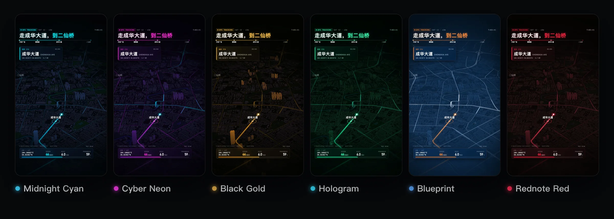
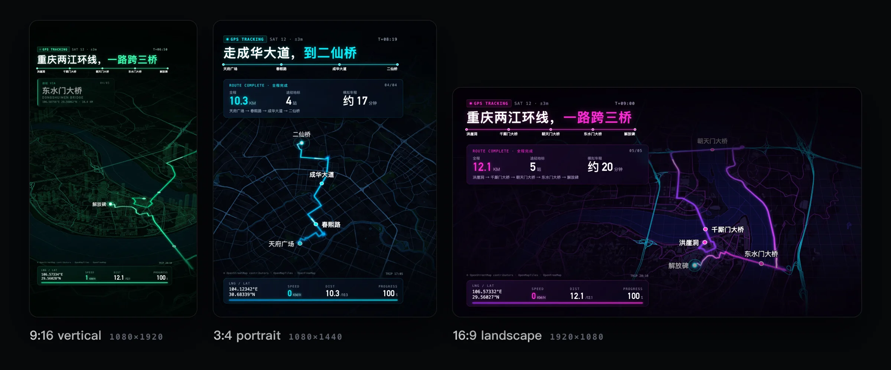
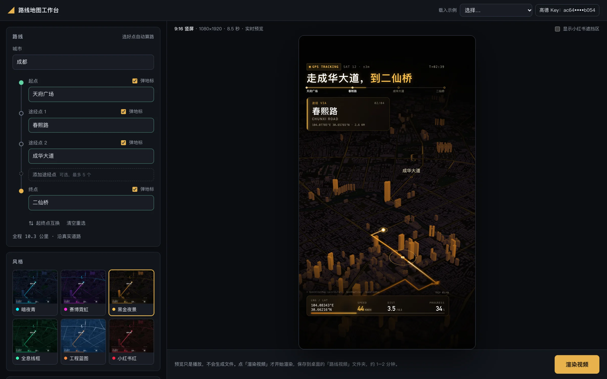
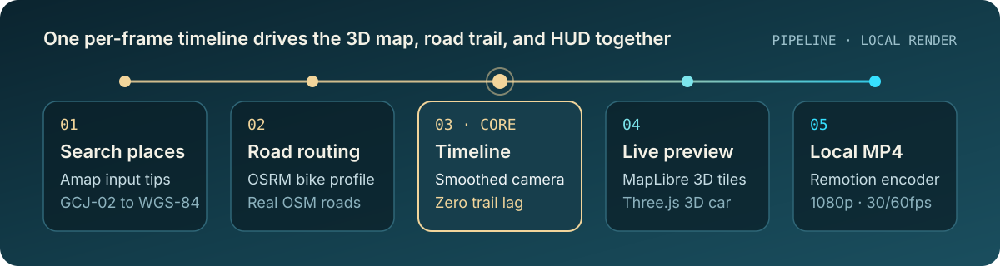

<p align="center">
  <a href="./README.md">简体中文</a> · <strong>English</strong>
</p>

<p align="center">
  
</p>
<p align="center"><sub>All frames on the right are real video renders from this workbench, not mockups.</sub></p>

<p align="center">
  A local route-animation workbench for travel vlogs, city walks, and cycling stories.<br>
  Pick a start, end, and optional stops on your Mac, choose a theme, preview live, and export 1080p MP4 locally.
</p>

<p align="center">
  <a href="#12-themes">12 Themes</a> ·
  <a href="#workbench">Workbench</a> ·
  <a href="#one-line-install">Install</a> ·
  <a href="#first-run-amap-key">Amap Key</a> ·
  <a href="#how-it-works">How It Works</a> ·
  <a href="#license--notices">License</a>
</p>

---

## 12 Themes

<p align="center">
  
</p>

One click switches the entire visual treatment—not just a color swap, but base map textures, 3D buildings, vehicle models, terrain relief, and HUD cards together (shown above with 10 themes on the Chengdu sample route and 2 real-terrain themes on Chongqing):

| Group | Themes | Visual Character |
| --- | --- | --- |
| **Night Neon** | Midnight Cyan · Cyber Neon · Hologram · Blueprint · Rednote Red | Dark 3D city massing with glowing trails for cinematic night routes |
| **Daylight** | Daylight · Miniature | Clean bright maps; **Miniature** adds tilt-shift blur and a **3D toy car** |
| **Paper & Toon** | Storybook · Vintage Paper · Ink Sketch | Paper grain and bold road casing; **Storybook** drives a **3D toy car** along turns |
| **Real Terrain** | Terrain Relief · Night Hills | True elevation relief and hillshading—dramatic in mountain cities like Chongqing |

---

## 3 Aspect Ratios

<p align="center">
  
</p>

- **9:16 Vertical (1080×1920)**: Ready for short-form platforms; HUD keeps clear of top/bottom/right overlays, with an optional safe-zone preview toggle.
- **3:4 Portrait (1080×1440)**: Tailored for portrait feeds and cover cards.
- **16:9 Landscape (1920×1080)**: Ready for full-screen travel vlogs and intros.

---

## Workbench

<p align="center">
  
</p>

The live preview and final export share the same scene and timeline logic (final exports use 2× supersampling to keep fine road lines crisp), and you can keep browsing other themes while a render runs.

| Panel | Capabilities |
| --- | --- |
| **Route** | City, start, end, and up to 5 optional stops (drag to reorder, swap ends, per-stop landmark toggle), same-city enforcement, and automatic route health checks |
| **Themes** | 12 themes in 4 groups with instant in-place switching |
| **Fields** | 3 aspect ratios, 30fps / 60fps output, 6–14 s duration, camera dynamics slider (steady ↔ lively), and 8 HUD component toggles |
| **Captions** | Two-tone title, GPS badge, bilingual landmark names, and closing route summary—all updating live |

Click **Render Video** at the bottom right to track progress around the button ring. Finished MP4 clips land in `Desktop/路线视频/` with one-click Reveal in Finder.

---

## One-Line Install

Paste this into Terminal on your Mac:

```bash
curl -fsSL https://raw.githubusercontent.com/manwithshit/route-map-studio/main/install.sh | bash
```

The script clones into `~/route-map-studio`, installs locked dependencies, and launches the workbench at `http://127.0.0.1:5317` (first run takes 1–3 minutes).

- **Requirements**: Apple silicon (M-series) Mac, [Node.js](https://nodejs.org) **22.12+ (LTS) / 24.x / 26+**, and `git` (`xcode-select --install`). Missing tools are reported with exact instructions.
- **No global clutter**: If `pnpm` is not installed globally, the script invokes `npx --yes pnpm@10` without modifying your global setup.
- **Start again later**:
  - With global `pnpm`: `cd ~/route-map-studio && pnpm start`
  - Without global `pnpm`: `cd ~/route-map-studio && npx --yes pnpm@10 start`
- **Update & custom directory**: Re-run the install command to update safely (origin and `main` branch are verified before pulling); install elsewhere with `curl -fsSL https://raw.githubusercontent.com/manwithshit/route-map-studio/main/install.sh | ROUTE_MAP_DIR=~/Apps/route-map bash`.

<details>
<summary>Manual clone & install (requires Node.js 22.12+ and pnpm 10+)</summary>

```bash
git clone https://github.com/manwithshit/route-map-studio.git
cd route-map-studio
pnpm install --frozen-lockfile
pnpm start
```

</details>

---

## First Run: Amap Key

On first launch, the workbench asks for an **Amap (高德) Web Service key** for place search (free for personal use):

1. Sign in to the [Amap console](https://console.amap.com/dev/key/app) and create an app under 「应用管理 → 我的应用」.
2. Add a key and select **「Web服务」 (Web Service)**. A 「Web端」 (JS API) key cannot query input tips; the workbench flags invalid key types automatically.
3. Copy only the 32-character key string (no security code needed).

**Privacy & outbound requests**:
- Your key is stored outside the web root at `~/.config/route-map-studio/config.local.json` (`0600` permissions, never committed, and blocked from local HTTP access). It is **sent over HTTPS only to Amap when validating the key and searching places**. Change or delete it anytime from the top-right key button.
- Search queries go to Amap Input Tips; chosen coordinates go to the community OSRM router; map/terrain tiles are fetched by viewport from OpenFreeMap and open elevation tile hosts.

---

## How It Works

<p align="center">
  
</p>

- **Single timeline source of truth**: Camera pose, trail progress, vehicle heading, speed, and landmark popups are precomputed per frame so the trail never lags behind the map.
- **Smooth camera on sharp turns**: Camera position and bearing are smoothed across the entire clip; the dynamics slider tunes how tightly the camera tracks turns.
- **Automatic route health checks**: Warns when a route is too short/long, too fast for the chosen duration, doubles back on side streets, or places two landmark cards too close together.

| Role | Service | Notes |
| --- | --- | --- |
| Place search | Amap Input Tips API | Uses your own Web Service key |
| Road routing | OSRM bike profile (`routing.openstreetmap.de`) | Free community service aligned with OpenStreetMap |
| 3D map & terrain | OpenFreeMap vector tiles + open elevation tiles | Pinned vector tile snapshot (glyphs & elevation tiles fetched upstream) |

### Current Limits

- Verified on **Apple silicon (M-series) Macs** only; Intel Macs and Windows are not supported yet.
- Scoped to **single-city routes** (up to 80 km): no country/province borders, administrative labels, or globe view. Map attribution remains visible per open data license.
- Always routes on the bike profile to avoid one-way car detours; routing and tiles rely on free community endpoints with fair-use limits.

---

## Development & Verification

`pnpm e2e` requires `ffprobe` on your machine (`brew install ffmpeg`).

```bash
pnpm typecheck   # TypeScript type checking
pnpm test        # Unit tests: coordinates, route checks, closed-loop timeline, safe zones, 12 themes, server guards
pnpm e2e         # End-to-end: security guards → search → route → 6s 3D-car render → ffprobe verification
pnpm studio      # Launch Remotion Studio for video component debugging
```

<details>
<summary>Project layout</summary>

```text
server/          Local Express server: security guard, key store, Amap search, OSRM routing, Remotion render queue
src/app/         Workbench UI (React + Vite): route, themes, fields, captions, and live preview
src/video/       Video engine (Remotion + MapLibre + Three.js): timeline, 12 themes, 3D car, HUD
src/shared/      Shared helpers: GCJ-02/WGS-84 conversion, route health checks, place name formatting
src/samples/     Built-in sample routes (Chengdu, Chongqing)
assets/readme/   README visuals and zero-dependency composer script (source/compose.mjs)
install.sh       macOS one-line install and launch script
docs/HANDOFF.md  Developer handoff notes (Chinese)
```

</details>

---

## License & Notices

- **Project source code**: [MIT License](./LICENSE).
- **Video engine**: Powered by [Remotion](https://www.remotion.dev/docs/license) (free for individuals and small teams; organizations exceeding Remotion's commercial threshold must follow Remotion's license terms).
- **Map & routing data**: Uses OpenStreetMap, OpenFreeMap, and open elevation tile services; keep map attribution visible and follow each provider's license and fair-use policy.
- **Bundled 3D model & showcase assets**: `public/models/toy-car.glb` and rendered showcase screenshots under `assets/readme/` are included for personal use and demonstration with this repository; verify rights separately before redistributing or using commercially.
