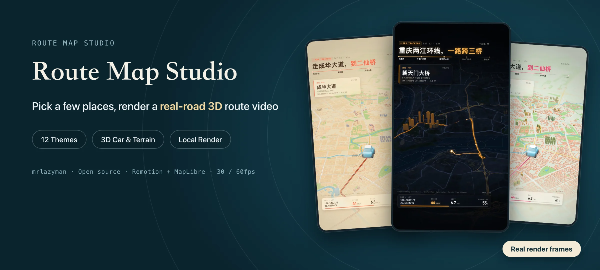

<p align="center">
  <a href="./README.md">简体中文</a> · <strong>English</strong>
</p>

<p align="center">
  
</p>

<p align="center">
  A local web workbench. Pick a start, an end and optional stops in one city, choose a theme, edit the captions, preview live, then render a 60fps route animation.
</p>

<p align="center">
  <a href="#one-line-install">Install</a> · <a href="#first-run">Amap key</a> · <a href="#how-it-works">How it works</a> · <a href="docs/HANDOFF.md">Dev handoff (Chinese)</a>
</p>

## One-line install

Paste this into Terminal on your Mac:

```bash
curl -fsSL https://raw.githubusercontent.com/manwithshit/route-map-studio/main/install.sh | bash
```

The script downloads the code to `~/route-map-studio`, installs dependencies and opens the workbench at `http://127.0.0.1:5317`. The first install takes 1–3 minutes.

- Requires an Apple silicon Mac, [Node.js](https://nodejs.org) 20+ and git (`xcode-select --install`). The script tells you exactly what is missing.
- pnpm is optional; the script calls it through npx without touching your global setup.
- Start again later with `cd ~/route-map-studio && pnpm start`. Running the install command again updates to the latest version.
- Install elsewhere: `curl -fsSL …/install.sh | ROUTE_MAP_DIR=~/Apps/route-map bash`.

<details>
<summary>Manual install</summary>

```bash
git clone https://github.com/manwithshit/route-map-studio.git
cd route-map-studio
pnpm install
pnpm start
```

</details>

## First run

The workbench asks for an **Amap (高德) Web Service key** for place search. Everyone uses their own free key:

1. Sign in to the [Amap console](https://console.amap.com/dev/key/app) and create an app.
2. Add a key and choose the **「Web服务」(Web Service)** platform. A 「Web端」(JS API) key cannot call place search; the workbench will say the key type is wrong.
3. Copy only the 32-character key. The security code is not needed.

The key is stored only in `config.local.json` on your machine. To change or delete it, click the 「高德 Key」 button at the top right of the workbench.

## Six themes

<p align="center">
  
</p>

One click changes the base map, buildings, roads, trail and HUD colours together.

## Three aspect ratios

<p align="center">
  
</p>

The vertical layout keeps the HUD clear of Xiaohongshu's top bar, bottom bar and side buttons, and the preview can overlay those zones.

## The workbench

<p align="center">
  
</p>

| Panel | What you can do |
| --- | --- |
| Route | City, start and end. Up to 5 optional stops, drag to reorder. All points must be in the same city |
| Theme | Six themes, click a thumbnail to switch |
| Fields | Aspect ratio, duration (6–14 s), camera dynamics (steady ↔ lively), 8 component toggles |
| Captions | Title, GPS label, Chinese and English name of each landmark, closing summary |

The preview runs the same component as the final render, so every change shows up immediately. Files are created only when you click Render; they go to `路线视频/` on your Desktop. An 8–10 second 1080×1920 clip renders in about a minute on an M5 MacBook.

## How it works

```text
Amap input tips ──▶ coordinates ──▶ OSRM road routing ──▶ per-frame timeline ──▶ Remotion MP4
 (place search)     (to WGS-84)     (OpenStreetMap)       (camera / trail / HUD)   (MapLibre 3D map)
```

- **One timeline for everything**: camera, trail progress, speed and landmark cards are computed per frame, and the map and HUD read the same result, so the trail never lags behind the camera.
- **No camera shake**: camera position and heading are smoothed over the whole clip, so sharp turns don't jerk. The dynamics slider sets how closely the camera follows the turns.
- **Route check**: warns when a route is too short or long, too fast, doubles back, or has landmarks too close together.

| Purpose | Service | Notes |
| --- | --- | --- |
| Place search | Amap input tips API | Your own Web Service key |
| Routing | OSRM bike profile (routing.openstreetmap.de) | Free community service on the same OpenStreetMap data as the map |
| Base map | OpenFreeMap vector tiles | Free community service, pinned version for repeatable renders |

The video stays at city scale: no national or provincial borders, no administrative labels, no globe view. Map data attribution is always shown.

## Limits

- Tested only on Apple silicon Macs. Intel Macs and Windows are not supported yet.
- Routing and tiles use free community services with fair-use limits.
- Routing always uses the bike network; car routing often detours around one-way streets.

## Development

```bash
pnpm typecheck
pnpm test        # unit tests: coordinates, route check, timeline continuity, safe zones
pnpm e2e         # end to end: server → routing → render a 6 s clip → check size and frames
pnpm studio      # Remotion Studio for the video component
```

All README images come from real renders and workbench screenshots; the composer script is in `assets/readme/source/`.
