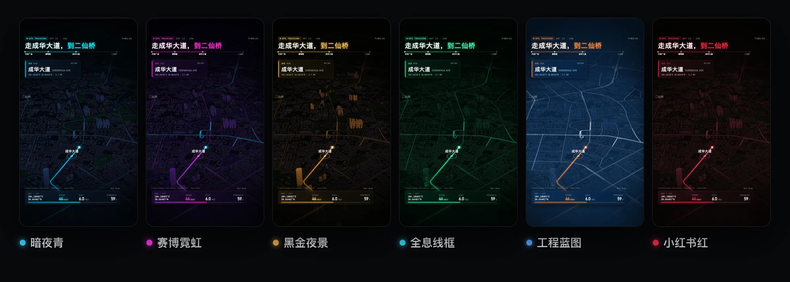

<p align="center">
  <strong>简体中文</strong> · <a href="./README.en.md">English</a>
</p>

<p align="center">
  
</p>

<p align="center">
  本地运行的网页工作台。选城市里的起点、终点和途经点，挑一套风格，改好文案，实时预览后渲染成 60fps 的路线动画视频。
</p>

<p align="center">
  <a href="#一键安装">一键安装</a> · <a href="#第一次使用">申请高德 Key</a> · <a href="#它怎么工作">工作原理</a> · <a href="docs/HANDOFF.md">开发交接</a>
</p>

## 一键安装

在 Mac 的「终端」里粘贴这一行，回车：

```bash
curl -fsSL https://raw.githubusercontent.com/manwithshit/route-map-studio/main/install.sh | bash
```

脚本会把代码下载到 `~/route-map-studio`，安装依赖，然后打开浏览器里的工作台 `http://127.0.0.1:5317`。首次安装约 1–3 分钟。

- 需要：Apple 芯片（M 系列）的 Mac、[Node.js](https://nodejs.org) 20 或更高、git（终端运行 `xcode-select --install` 即可装上）。缺哪个，脚本会直接告诉你怎么装。
- 没装 pnpm 也可以，脚本会临时调用，不改动你的全局环境。
- 以后再启动：`cd ~/route-map-studio && pnpm start`。再运行一次安装命令，就会更新到最新版。
- 想装到别的目录：`curl -fsSL …/install.sh | ROUTE_MAP_DIR=~/Apps/route-map bash`。

<details>
<summary>不想用脚本，手动安装</summary>

```bash
git clone https://github.com/manwithshit/route-map-studio.git
cd route-map-studio
pnpm install
pnpm start
```

</details>

## 第一次使用

打开工作台后，会先让你填一个**高德 Web服务 Key**，用来搜地点。每个人用自己的 Key，免费申请：

1. 登录 [高德开放平台控制台](https://console.amap.com/dev/key/app)，「应用管理 → 我的应用」里创建一个应用。
2. 给应用添加 Key，**服务平台选「Web服务」**。选成「Web端（JS API）」的 Key 搜不了地点，工作台会提示 `Key 类型不对`。
3. 只复制「Key」那一列的 32 位字符，安全密钥不用填。

Key 只保存在你电脑上的 `config.local.json`，不会上传。要换 Key 或删掉它，点工作台右上角的「高德 Key」按钮。

## 13 套风格

<p align="center">
  
</p>

同一条路线，换一套风格只是点一下。每套风格同时改底图、楼块、道路、轨迹和界面的配色。除了下图这 6 套夜景霓虹风格，还有日间清新（清新日间、微缩模型）、纸感手绘（复古纸图、钢笔线稿、手账卡通）和真实地形（山野地形、夜色山城）三组，共 13 套。

## 3 种画幅

<p align="center">
  
</p>

竖屏默认避开小红书的顶栏、底栏和右侧按钮区，预览里可以叠加遮挡区检查。

## 工作台

<p align="center">
  
</p>

| 区域 | 可以做什么 |
| --- | --- |
| 路线 | 选城市、起点、终点。途经点可选，最多 5 个，拖动排序。所有点要在同一个城市 |
| 风格 | 6 套主题，点缩略图切换 |
| 字段 | 画幅、时长（6–14 秒）、镜头动感（平稳 ↔ 灵动）、8 个画面组件开关 |
| 文案 | 标题、GPS 标签、每个地标的中英文名、结尾路线摘要 |

右侧预览和最终成片用的是同一套画面代码，改什么都马上能看到。点「渲染视频」才会生成文件，保存在桌面的 `路线视频/` 文件夹。一条 8–10 秒的 1080×1920 视频，在 M5 MacBook 上大约渲染 1 分钟。

## 它怎么工作

```text
高德输入提示 ──▶ 地点坐标 ──▶ OSRM 沿真实道路算路 ──▶ 逐帧时间轴 ──▶ Remotion 渲染 MP4
 （搜地点）      （转 WGS-84）   （OpenStreetMap 路网）   （镜头 / 轨迹 / 界面）    （MapLibre 3D 底图）
```

- **一份时间轴驱动所有画面**：镜头位置、轨迹进度、车速和地标卡都按帧算好，地图和界面读同一份结果，轨迹不会落后于画面。
- **镜头不抖**：镜头位置和朝向在整段时间上做平滑，路口急转也不会突然甩一下。“镜头动感”滑块调的是镜头跟着路线转向的程度。
- **路线体检**：路线太短、太长，车速过快、来回折返，或者两个地标挨得太近，都会提示怎么改。

| 用途 | 服务 | 说明 |
| --- | --- | --- |
| 地点搜索 | 高德输入提示 API | 需要自己的 Web服务 Key |
| 算路 | OSRM 骑行路网（routing.openstreetmap.de） | 公益服务，和底图是同一份 OpenStreetMap 路网 |
| 底图 | OpenFreeMap 矢量瓦片 | 公益服务，版本锁定，重复渲染结果一致 |

画面只做城市尺度：不显示国界、省界和行政区文字，也没有地球视角。画面右下角的地图数据署名按许可要求始终显示。

## 限制

- 只在 Apple 芯片 Mac 上测试过，Intel Mac、Windows 暂不支持。
- 算路和底图用的是公益免费服务，个人使用没问题，大量调用可能被限流。
- 算路固定用骑行路网：驾车路网受单行道影响，常常绕远或掉头。

## 开发

```bash
pnpm typecheck   # 类型检查
pnpm test        # 单元测试：坐标转换、路线体检、时间轴连续性、安全区布局
pnpm e2e         # 端到端：起服务 → 算路 → 渲染 6 秒短片 → 检查分辨率和帧数
pnpm studio      # 用 Remotion Studio 调试视频组件
```

```text
server/          本地服务：Key 存储、高德搜索、算路、渲染任务
src/app/         工作台前端（React + Vite）
src/video/       视频组件（Remotion）：时间轴、地图样式、界面、主题、画幅布局
src/shared/      前后端共用：坐标转换、路线体检、地名处理
src/samples/     内置示例路线（成都、重庆）
install.sh       一键安装脚本
docs/HANDOFF.md  开发交接文档
```

README 里的图片都来自真实成片和工作台截图，生成脚本在 `assets/readme/source/`。
