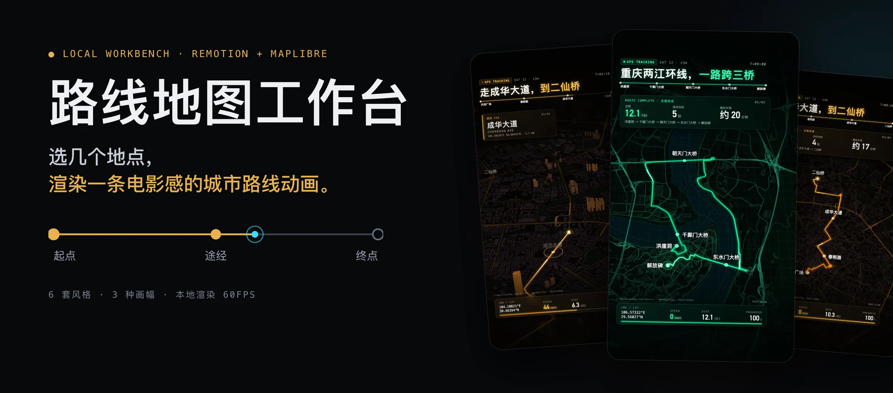
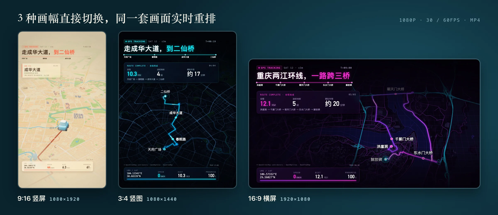
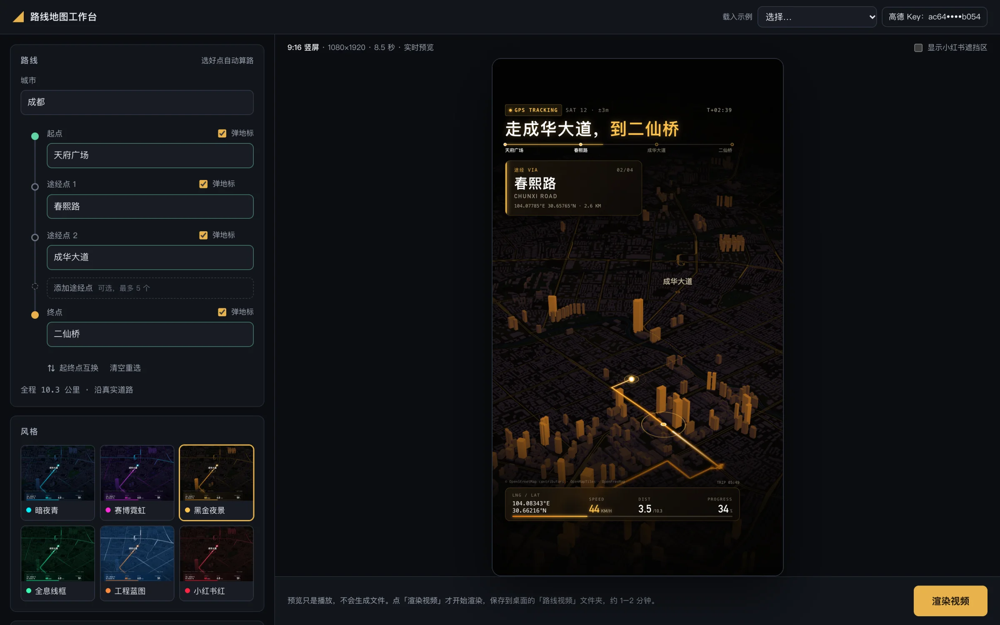
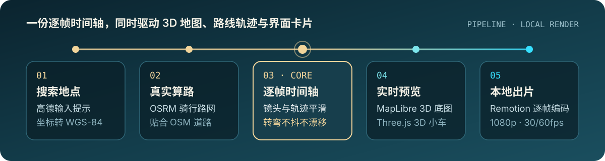

<p align="center">
  <strong>简体中文</strong> · <a href="./README.en.md">English</a>
</p>

<p align="center">
  
</p>
<p align="center"><sub>上方右侧均为本工具渲染出的真实成片抽帧，非概念图。</sub></p>

<p align="center">
  面向旅行 vlog、城市探店与骑行记录的本地路线动画工作台。<br>
  在 Mac 上选好起终点与途经点，挑一套风格，实时预览后一键导出 1080p MP4。
</p>

<p align="center">
  <a href="#12-套风格">12 套风格</a> ·
  <a href="#工作台">工作台</a> ·
  <a href="#一键安装">一键安装</a> ·
  <a href="#首次使用高德-key">高德 Key</a> ·
  <a href="#工作原理">工作原理</a> ·
  <a href="#许可证与素材说明">许可证</a>
</p>

---

## 12 套风格

<p align="center">
  
</p>

点一下缩略图即可切换整套画法——不只是换配色，底图材质、3D 楼块、车头模型、地形起伏与界面卡片会一起变化（上图以成都路线展示前 10 套，重庆山城路线展示 2 套真实地形）：

| 风格分组 | 包含主题 | 视觉特点 |
| --- | --- | --- |
| **夜景霓虹** | 暗夜青 · 赛博霓虹 · 全息线框 · 工程蓝图 · 小红书红 | 暗色 3D 城市楼群与发光轨迹，适合科技感与城市夜景 |
| **日间清新** | 清新日间 · 微缩模型 | 明亮洁净底图；**微缩模型**带上下移轴虚化与 **3D 玩具小车** |
| **纸感手绘** | 手账卡通 · 复古纸图 · 钢笔线稿 | 纸张质感与粗描边道路；**手账卡通**配有沿路转弯的 **3D 玩具小车** |
| **真实地形** | 山野地形 · 夜色山城 | 真实海拔起伏与山体阴影，重庆等山城与户外路线立体感明显 |

---

## 3 种画幅

<p align="center">
  
</p>

- **9:16 竖屏（1080×1920）**：适配短视频与竖屏 vlog，HUD 默认避开顶栏、底栏与右侧互动按钮区，预览里可勾选叠加遮挡区检查。
- **3:4 竖图（1080×1440）**：适合图文卡片与竖向展示。
- **16:9 横屏（1920×1080）**：适合横屏 vlog 与大屏讲解片头。

---

## 工作台

<p align="center">
  
</p>

右侧预览与最终导出共用同一套场景与时间轴逻辑（正式导出采用 2× 超采样以减少细路网闪烁）；渲染过程中仍可继续点击预览其他风格。

| 左侧面板 | 可以做什么 |
| --- | --- |
| **路线** | 选择城市、起点、终点与最多 5 个可选途经点（支持拖动排序、起终点互换、单点关闭地标卡），所有点限定同一城市并自带路线体检 |
| **风格** | 4 组共 12 套主题，点缩略图原地切换 |
| **字段** | 3 种画幅、30fps / 60fps 帧率、6–14 秒时长、镜头动感（平稳 ↔ 灵动）、8 个画面组件自由开关 |
| **文案** | 顶部双色标题、GPS 标签、每个地标的中英文名、结尾路线摘要，改完即刻刷新预览 |

点击右下角「渲染视频」，进度绕着按钮外圈实时推进；完成后保存在桌面 `路线视频/` 文件夹，并支持一键在 Finder 中定位。

---

## 一键安装

在 Mac 的「终端」里粘贴这一行回车：

```bash
curl -fsSL https://raw.githubusercontent.com/manwithshit/route-map-studio/main/install.sh | bash
```

脚本会把仓库下载到 `~/route-map-studio`，使用冻结锁文件安装依赖并自动打开本地工作台 `http://127.0.0.1:5317`（首次约 1–3 分钟）。

- **环境要求**：Apple 芯片（M 系列）Mac、[Node.js](https://nodejs.org) **22.12+（LTS）/ 24.x / 26+**、`git`（运行 `xcode-select --install` 即可安装）。缺哪项脚本会直接给出提示。
- **零全局污染**：未全局安装 `pnpm` 时，脚本会通过 `npx --yes pnpm@10` 临时调用，不改动你的全局环境。
- **后续启动**：
  - 已全局安装 `pnpm`：`cd ~/route-map-studio && pnpm start`
  - 未全局安装 `pnpm`：`cd ~/route-map-studio && npx --yes pnpm@10 start`
- **更新与自定义目录**：重新跑一遍安装命令即可安全更新（会核对仓库来源与 `main` 分支，不会误操作无关目录）；自定义目录可用 `curl -fsSL https://raw.githubusercontent.com/manwithshit/route-map-studio/main/install.sh | ROUTE_MAP_DIR=~/Apps/route-map bash`。

<details>
<summary>手动克隆安装（需 Node.js 22.12+ 与 pnpm 10+）</summary>

```bash
git clone https://github.com/manwithshit/route-map-studio.git
cd route-map-studio
pnpm install --frozen-lockfile
pnpm start
```

</details>

---

## 首次使用：高德 Key

首次打开工作台会引导填写一个**高德「Web服务」Key**（仅用于地点搜索，个人可免费申请）：

1. 登录 [高德开放平台控制台](https://console.amap.com/dev/key/app)，在「应用管理 → 我的应用」新建一个应用。
2. 点击「添加 Key」，**服务平台务必选择「Web服务」**（选成「Web端（JS API）」无法搜地点，工作台会明确提示 `Key 类型不对`）。
3. 只复制「Key」列里的 32 位字符即可，不需要安全密钥。

**隐私与数据去向说明**：
- Key 保存在本机 `~/.config/route-map-studio/config.local.json`（位于 Web 根目录之外，权限 `0600`，不进 Git 仓库且不可通过本地 HTTP 访问）；**仅在验证 Key 与搜索地点时通过 HTTPS 发送给高德开放平台**，不会发往其他第三方服务。随时可点工作台右上角「高德 Key」更换或删除。
- 地点搜索词会发往高德输入提示接口；选定路线的经纬度会发往 OSRM 公益服务算路；底图与地形瓦片按视野直接向 OpenFreeMap 与开源地形瓦片服务拉取。

---

## 工作原理

<p align="center">
  
</p>

- **一份时间轴驱动全部画面**：镜头位置、路线生长进度、车头朝向、速度与地标卡全部按帧预计算，地图和界面读同一份状态，轨迹不会落后于画面。
- **路口急弯不甩头**：镜头位置与朝向在整段时间上做全局平滑，「镜头动感」滑块可自由平衡稳重与贴弯跟随。
- **路线自动体检**：路线过短或过长、车速过快、途经点折返重叠、相邻地标过近导致撞卡时，会自动弹出调整建议。

| 用途 | 底层服务 | 说明 |
| --- | --- | --- |
| 地点搜索 | 高德输入提示 API | 使用你自己的 Web服务 Key |
| 真实算路 | OSRM 骑行路网（`routing.openstreetmap.de`） | 公益服务，与底图共享 OpenStreetMap 路网 |
| 3D 底图与地形 | OpenFreeMap 矢量瓦片 + 开源地形瓦片 | 矢量瓦片固定快照版本（字体与地形瓦片按上游在线拉取） |

### 当前边界

- 仅在 **Apple 芯片（M 系列）Mac** 验证过，Intel Mac 与 Windows 暂不支持。
- 画面限定**同一座城市尺度**（上限 80 公里），不展示国界/省界、行政区文字与地球视角；按开源地图许可要求，画面底部始终保留地图数据署名。
- 算路固定采用骑行路网，避免驾车路网受单行道影响产生无意义绕行；算路与底图依赖公益服务，请合理控制个人使用频率。

---

## 开发与验证

运行 `pnpm e2e` 需要本机安装 `ffprobe`（可通过 `brew install ffmpeg` 安装）。

```bash
pnpm typecheck   # TypeScript 静态类型检查
pnpm test        # 单元测试：坐标转换、路线体检、时间轴与闭合环线、安全区、12 套主题与服务安全边界
pnpm e2e         # 端到端测试：安全校验 → 搜点 → 算路 → 渲染 6 秒 3D 小车短片 → ffprobe 校验规格
pnpm studio      # 启动 Remotion Studio 调试视频组件
```

<details>
<summary>目录结构</summary>

```text
server/          本地 Express 服务：安全防护、Key 存取、高德搜索、OSRM 算路、Remotion 渲染队列
src/app/         工作台前端（React + Vite）：路线/风格/字段/文案四区与实时预览
src/video/       视频组件（Remotion + MapLibre + Three.js）：时间轴、12 套主题、3D 小车与 HUD
src/shared/      前后端共用：GCJ-02/WGS-84 坐标转换、路线体检、地名处理
src/samples/     内置示例路线（成都、重庆）
assets/readme/   README 视觉素材与无依赖合成脚本（source/compose.mjs）
install.sh       macOS 一键安装与启动脚本
docs/HANDOFF.md  开发交接文档
```

</details>

---

## 许可证与素材说明

- **本项目自有代码**：采用 [MIT License](./LICENSE)。
- **渲染引擎**：依赖 [Remotion](https://www.remotion.dev/docs/license)（个人及小团队可免费使用，若用于达到其商业规模门槛的组织请遵守 Remotion 官方许可条款）。
- **地图与路网数据**：底图与路网数据来自 OpenStreetMap、OpenFreeMap 及开源地形瓦片服务，请保留画面中的地图数据署名并遵循各自数据许可。
- **内置模型与演示素材**：`public/models/toy-car.glb` 及 `assets/readme/` 下的真实渲染截图随本项目用于个人使用与功能展示；二次分发或商业使用前请自行确认相关模型及第三方资源的授权边界。
